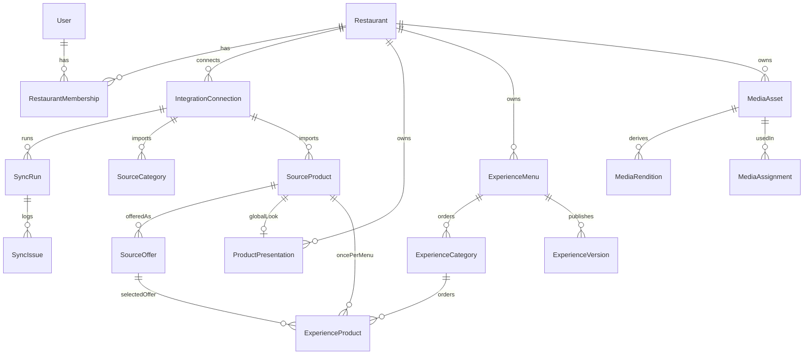

# Modelo de domínio

Referência para a modelagem física no PostgreSQL. Fonte vigente: [Blueprint v0.5](../product/blueprint-v0.5.md). A [v0.4](../product/blueprint-v0.4.md) permanece como histórico. Não há migration. Entidade marcada como recomendada não é decisão confirmada.

Toda entidade de restaurante tem `restaurant_id` próprio ou alcançável por relação controlada. Isolamento: [security.md](security.md).

## Identidade

### User

Identidade de quem administra a plataforma. Autenticação prevista: Supabase Auth. O blueprint não fixa e-mail, magic link nem OAuth. Isso está pendente.

### Restaurant

Restaurante dentro do Feels. Dono das conexões, cardápios, apresentações e da biblioteca de mídia.

### RestaurantMembership

Liga usuário e restaurante.

Campos citados no blueprint: `restaurant_id`, `user_id`, `status`, `created_at`.

Regra confirmada: na V1 todos os membros têm o mesmo nível funcional de permissão. Ações críticas exigem confirmação explícita e continuam sujeitas a autenticação e autorização.

Um usuário administra vários restaurantes. Um restaurante tem vários usuários.

## Integração

### IntegrationConnection

Conexão do restaurante com um sistema externo.

Campos sugeridos: `id`, `restaurant_id`, `provider`, `external_merchant_id`, `credentials_reference`, `integration_version`, `status`, `last_sync_at`, `created_at`, `updated_at`.

`credentials_reference` aponta para o cofre. O segredo não fica na linha em texto aberto. `provider` isola o OpenDelivery de integrações futuras.

### SyncRun

Uma execução de sincronização.

Campos sugeridos: `id`, `integration_connection_id`, `started_at`, `completed_at`, `status`, `source_last_update`, `records_processed`, `records_created`, `records_updated`, `records_archived`, `error_summary`.

### SyncIssue

Problema de uma execução.

Campos sugeridos: `id`, `sync_run_id`, `entity_type`, `external_id`, `severity`, `message`, `resolved_at`.

## Catálogo de origem

Identidade única recomendada para registro importado: conexão, tipo de entidade e identificador externo. O código externo do PDV, quando o protocolo enviar, fica guardado para reconciliação. A estabilidade desses identificadores no fornecedor do piloto **não foi validada**.

### SourceCategory

Categoria recebida do sistema externo. Permanece para sincronização e rastreabilidade, mesmo quando o cardápio de experiência não a usa.

### SourceProduct

Produto original (`Item` no OpenDelivery): nome, descrição, imagem e demais atributos do item. Não carrega o preço de uma oferta.

### SourceOffer

Oferta do produto. Preço, disponibilidade, categoria e índice podem variar por menu ou serviço de origem.

**Decisão aceita (C4):** várias ofertas do mesmo produto são importadas. Cada cardápio seleciona uma. `ExperienceProduct` referencia `source_offer_id`. Ver [ADR 0005](decisions/0005-experience-product-source-offer.md).

### SourceOptionGroup e SourceOption

Grupos e opções como o fornecedor enviou. Preservam identificador externo e dados originais. O quanto disso aparece na V1 visual está pendente.

### Entidades recomendadas para cumprir a seção 7.2

O blueprint manda preservar Menu, Service e Availability. A lista da seção 5.2 não dá nome a essas entidades. Proposta, conflito C5:

- `SourceMenu`
- `SourceService`
- `SourceAvailability`

Sem essas tabelas, a relação pedida não tem lugar estável. Aprovar ou rejeitar antes da primeira migration.

## Experiência

### ProductPresentation

Apresentação global do produto: título comercial, descrição comercial, imagem principal, vídeo e elementos visuais. Não guarda preço nem disponibilidade.

### ExperienceMenu

Cardápio criado no Feels.

Campos sugeridos: `id`, `restaurant_id`, `name`, `slug`, `is_default`, `status`.

Regra confirmada (C2): existe um cardápio padrão. O link principal abre esse cardápio em `/`. O hub fica em `/hub`. Outro cardápio abre em `/:restaurantSlug/:menuSlug`.

O cardápio aponta a versão ativa da camada de experiência. A data de publicação fica nessa versão (C7, consequência da C3). O código atual ainda não tem essas rotas.

### ExperienceCategory

Categoria dentro de um cardápio. Pode nascer no Feels ou vincular uma categoria de origem.

Campos sugeridos: `id`, `experience_menu_id`, `source_category_id` (nulo quando a categoria é própria), `name`, `position`, `origin_type`.

Regras confirmadas:

- Categorias de origem e categorias próprias coexistem.
- O vínculo com a origem é opcional.
- Renomear ou remover a categoria de origem não tem regra fechada. Pendência em [open-decisions.md](../product/open-decisions.md).

### ExperienceProduct

Presença de uma oferta num cardápio.

Campos: `id`, `experience_menu_id`, `experience_category_id`, `source_offer_id`, `source_product_id`, `position`, `visibility`, `presentation_override`, `created_at`, `updated_at`.

Regras aceitas (C4):

- Unicidade: `UNIQUE (experience_menu_id, source_product_id)`.
- `source_offer_id` é a oferta escolhida para aquele produto naquele cardápio.
- `source_product_id` deriva dessa oferta ou permanece consistente. A integridade referencial impede os dois valores divergirem.
- O mesmo produto pode aparecer em outro cardápio, em outra categoria, com outra oferta e com outra ordem.
- Exemplo: Cappuccino Delivery a R$ 15 e Cappuccino Takeout a R$ 13 ficam na origem. Um cardápio escolhe uma.
- `presentation_override` não altera dado operacional.
- Recomendação C6, pendente: esse campo guarda só título e descrição; mídia vai para `MediaAssignment`.
- Oferta arquivada na origem: o registro de experiência não é apagado. Ocultar ou manter referência visível no admin está pendente. Na experiência pública, indisponível fica oculto.

Precedência de apresentação, recomendada para o detalhamento: sobrescrita do cardápio, depois apresentação global, depois valor de origem. O sync escreve nas tabelas de origem e não nas de apresentação.

## Mídia

### MediaAsset

Arquivo da biblioteca do restaurante. Origem do conteúdo:

- `source`: veio do sistema de origem.
- `restaurant_upload`: o restaurante enviou.
- `feels_content`: o Feels disponibilizou.

A sincronização não sobrescreve mídia criada ou enviada pelo restaurante ou pelo Feels.

`feels_content` reutilizado por vários restaurantes não tem dono único. Conflito C8, pendente: catálogo global somente leitura e atribuição por restaurante.

### MediaRendition

Versão derivada do original: miniatura, imagem otimizada, vídeo otimizado, outras resoluções. O original permanece.

### MediaAssignment

Liga mídia a produto e contexto. Permite configuração global e sobrescrita por cardápio.

## Entidades da publicação híbrida

Aceitas com a C3. Ver [ADR 0006](decisions/0006-publicacao-versionada.md).

- Versão da camada de experiência: congela seleção, categorias, ordenação, títulos comerciais, descrições comerciais, imagens, vídeos e configurações visuais. O cardápio aponta a versão ativa.
- Camada operacional: preço, disponibilidade, status e arquivamento, atualizados pela sincronização. Não fazem parte do que a publicação congela.

`AuditEvent` continua recomendação, não decisão. `SourceMenu`, `SourceService` e `SourceAvailability` também (C5).

## Relações

`ExperienceProduct` referencia a oferta selecionada e o produto derivado dela. A unicidade é por cardápio e produto (C4). A versão da experiência é a camada congelada (C3). Preço e disponibilidade não entram nessa versão.

## Regras de negócio

1. Preço e disponibilidade vêm da origem. O Feels não os edita e não os envia de volta.
2. Indisponível é importado e não aparece na experiência pública.
3. Ausência num snapshot completo arquiva o registro de origem. Não há exclusão física.
4. Arquivar preserva histórico, mídia, apresentação e referências de cardápio.
5. Sync é idempotente: repetir não duplica e não apaga personalização comercial.
6. Um produto aparece uma vez por cardápio, na oferta selecionada. A restrição é `UNIQUE (experience_menu_id, source_product_id)`.
7. Cardápios do mesmo restaurante não compartilham ordem nem seleção.
8. Mídia `restaurant_upload` e `feels_content` sobrevive ao sync.
9. Credencial não fica em texto aberto.
10. Ação crítica pede confirmação explícita, além de autenticação e autorização.
